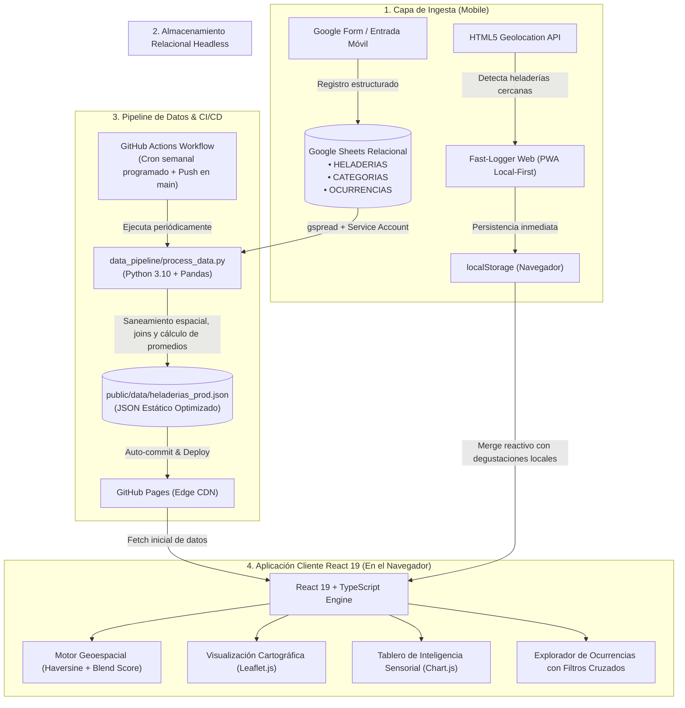

# GustoHelado — Bitácora Sensorial & Motor de Recomendación Geoespacial

[English](README.md) | [Español](README.es.md)

[](https://zebok.github.io/GUSTOHELADO/)
[](https://react.dev/)
[](https://www.typescriptlang.org/)
[](https://pandas.pydata.org/)
[](https://web.dev/progressive-web-apps/)
[](https://github.com/features/actions)
[](LICENSE)

> **Plataforma personal de analítica sensorial, recolección de datos mobile-first (PWA) y motor de recomendación en tiempo real, construida sobre un dataset longitudinal vivo de degustaciones registradas desde 2010 en heladerías de Buenos Aires y el mundo.**

---

## 📌 Visión del Proyecto

**GustoHelado** es un proyecto de ingeniería de software y datos de punta a punta (*end-to-end*) que transforma una pasión personal de más de una década en un producto digital de alta precisión.

A diferencia de plataformas comerciales genéricas como Google Maps o TripAdvisor —donde las reseñas sufren de sesgos comerciales, subjetividad no estandarizada y puntuaciones planas de 5 estrellas—, este sistema implementa:
1. **Una ontología taxonómica bidimensional propia** (6 Macrocategorías de sabor × 4 Subcategorías estructurales).
2. **Un modelo matemático de evaluación sensorial ponderado** (Disfrutabilidad 40%, Textura/Frío 25%, Fidelidad organoléptica 20%, Experiencia/Formato 15%).
3. **Un algoritmo híbrido de recomendación geoespacial en el cliente** (*Blend Score*) que resuelve distancia lineal viva (fórmula de Haversine) y afinidad de antojo en milisegundos sin latencia de red.
4. **Una arquitectura serverless de costo operativo cero ($0/mes)** basada en almacenamiento relacional headless, pipelines ETL automatizados en Python y distribución estática inmutable en el borde (Edge CDN).

---

## 🏛️ Arquitectura del Sistema & Flujo de Datos

El diseño arquitectónico prioriza **desacoplamiento total, costo cero de infraestructura y alta disponibilidad**.



### Cómo funciona el circuito de datos:
1. **Ingesta estructurada:** Cuando visito una heladería, registro la degustación mediante el formulario móvil o la interfaz táctil de la PWA. Los registros se almacenan de forma relacional mediante claves únicas (`heladeria_id`, `categoria_id`).
2. **Transformación automatizada (ETL):** El script de Python ([`process_data.py`](data_pipeline/process_data.py)) lee las pestañas relacionales, valida coordenadas geográficas, precalcula los promedios ponderados por local y categoría, y emite un archivo JSON estático optimizado.
3. **Orquestación y Despliegue (CI/CD):** GitHub Actions ([`pipeline.yml`](.github/workflows/pipeline.yml)) ejecuta el pipeline automáticamente en cada actualización de código o de forma programada todas las semanas, compilando la aplicación y desplegándola a GitHub Pages.
4. **Procesamiento reactivo en el cliente:** El navegador descarga el JSON estático y ejecuta los cálculos de geolocalización viva, radios de caminata y filtros de forma instantánea sin requerir consultas a bases de datos en la nube.

---

## 📐 Modelo de Datos y Formulación Algorítmica

### 1. Ontología Taxonómica Bidimensional
El sistema desacopla estrictamente **el perfil del sabor** de **su ejecución física estructural**:

```
[ Universo GustoHelado ]
  ├── 1. Macrocategoría (Familia de Sabor)
  │     ├── DULCE DE LECHE
  │     ├── CHOCOLATE
  │     ├── CREMA (Lácteos, Frutos Secos y Pastelería)
  │     ├── FRUTA (Sorbete al agua y emulsiones)
  │     ├── AUTOR (Creaciones insignia de la heladería)
  │     └── MISC (Golosinas, alfajores, combinados)
  │
  └── 2. Subcategoría (Estructura Física del Helado)
        ├── CLÁSICO   → Sabor puro sin agregados sólidos ni fusiones (ej. Chocolate Amargo, Pistacho puro).
        ├── SPRINKLES → Gusto base + agregados sólidos (chips, nueces, almendras, brownie, merengue).
        ├── FUSIÓN    → Emulsión con líquidos/salsas o 3+ componentes integrados (Lemon Pie, Tiramisú, Chocotorta).
        └── LIGHT     → Formulaciones reducidas en azúcar, bajas calorías, sin TACC o veganas funcionales.
```

### 2. Ecuación de Calificación Sensorial Ponderada
Cada ocurrencia se califica numéricamente en escala continua de `0.0` a `10.0` con un decimal:

$$\text{Puntaje General} = 0.40 \cdot \text{Disfrutabilidad} + 0.25 \cdot \text{Textura} + 0.20 \cdot \text{Fidelidad} + 0.15 \cdot \text{Experiencia}$$

$$\text{donde:}$$
* **Disfrutabilidad ($40\%$):** Componente hedónico puro; nivel de placer en boca.
* **Textura / Conservación ($25\%$):** Parámetro físico-químico. Evalúa punto de fusión, reactividad al derretirse y **ausencia total de escarcha / cristales de hielo** (penaliza defectos térmicos tanto en cremas como al agua).
* **Fidelidad al Gusto ($20\%$):** Veracidad organoléptica respecto al ingrediente anunciado (ingredientes nobles vs. aromatizantes artificiales).
* **Experiencia & Presentación ($15\%$):** Calidad del formato y servicio (crocancia del cucurucho waffle, prolijidad del vasito o envase térmico de alta densidad vs. telgopor quebradizo).
* **Métrica Booleana ($\text{Repeat Rate}$):** Variable de control binaria: *¿Volvería a pedir este gusto en esta heladería específica?*

### 3. Algoritmo de Recomendación Híbrido (*Blend Score*)
Al solicitar recomendaciones, el motor evalúa en vivo cada heladería activa dentro del radio seleccionado:

$$\text{Distancia} = 2 R \cdot \arcsin\left(\sqrt{\sin^2\left(\frac{\Delta\text{lat}}{2}\right) + \cos(\text{lat}_1)\cos(\text{lat}_2)\sin^2\left(\frac{\Delta\text{lng}}{2}\right)}\right)$$

$$\text{Score Final} = 0.70 \cdot \left(\frac{\text{Score Promedio Categorías}}{10}\right) + 0.30 \cdot \left(1 - \frac{\text{Distancia}}{\text{Radio Máximo}}\right)$$

El resultado equilibra la excelencia histórica del local con el esfuerzo de caminata del usuario.

---

## 💻 Funcionalidades Principales

* **Intro Editorial & Storytelling:** Narrativa interactiva con animación de máquina de escribir en vivo, estadísticas dinámicas del catálogo y visualización de la ontología y fórmula matemática.
* **Motor "¿Qué pido hoy?":** Selector reactivo de antojos, radio de búsqueda y ubicación por GPS, dirección o saltos rápidos por barrios de CABA (*Belgrano, Palermo, Centro*) y ciudades del mundo (*Berlín, Aarhus, Ámsterdam, Bariloche, Montevideo, Ubatuba*).
* **Machete Personal de Heladería:** Cada tarjeta del mapa y del buscador analiza el historial previo en ese local para indicar qué sabores fueron un acierto (*"Qué pedir acá"*) y cuáles descartar (*"Evitar"*).
* **Carga Rápida Móvil (PWA):** Flujo táctil para cargar degustaciones en segundos, con detección de locales cercanos a menos de 50 metros por GPS, inferencia predictiva de subcategorías y persistencia local-first.
* **Tablero de Análisis Sensorial (KPIs):** Visualización interactiva con Chart.js de la evolución cronológica de degustaciones, comparativas por categoría, desglose por métrica y filtros combinables por país, heladería y subcategoría.
* **Bitácora Abierta de Datos:** Tabla completa de ocurrencias y catálogo de heladerías con ordenamiento dinámico por columnas y búsqueda libre.

---

## 👤 Autor

**Sebastián Porrini**  
Software Engineer & Data Enthusiast  
* Buenos Aires, Argentina  
* GitHub: [@zebok](https://github.com/zebok)  
* Proyecto en Vivo: [zebok.github.io/GUSTOHELADO](https://zebok.github.io/GUSTOHELADO/)

---

## 📄 Licencia

Este proyecto se distribuye bajo la licencia MIT. Consultá el archivo `LICENSE` para más información.
