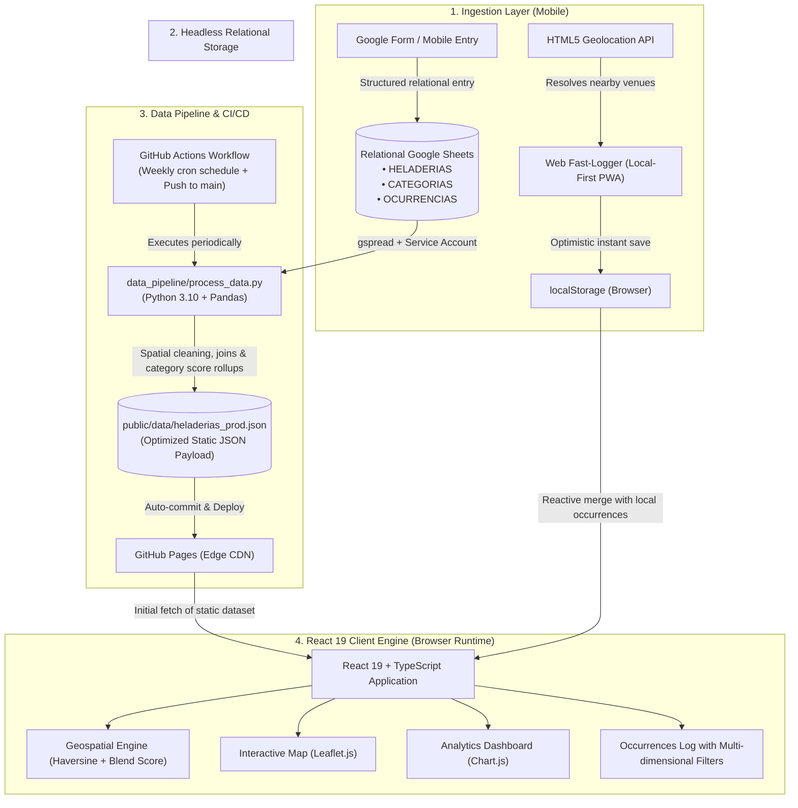

# GustoHelado — Sensory Intelligence & Geospatial Recommendation Engine

[English](README.md) | [Español](README.es.md)

[](https://zebok.github.io/GUSTOHELADO/)
[](https://react.dev/)
[](https://www.typescriptlang.org/)
[](https://pandas.pydata.org/)
[](https://web.dev/progressive-web-apps/)
[](https://github.com/features/actions)
[](LICENSE)

> **A personal sensory analytics platform, mobile-first PWA data capture tool, and real-time recommendation engine engineered on a living longitudinal dataset of tastings logged since 2010 across artisanal gelaterias in Buenos Aires and worldwide.**

---

## 📌 Project Vision

**GustoHelado** is an end-to-end software and data engineering project that translates an ongoing, multi-year personal passion into a high-precision digital product.

Unlike commercial crowd-sourced platforms such as Google Maps or TripAdvisor — where reviews suffer from advertising bias, unstandardized subjectivity, and flat 5-star ratings that treat mass-produced ice cream identically to micro-batch gelato —, this system implements:
1. **A custom 2-dimensional gastronomic taxonomy** (6 Macro-categories × 4 Structural subcategories).
2. **A weighted sensory scoring model** (40% Enjoyability, 25% Texture & Cold Stability, 20% Flavor Fidelity, 15% Presentation & Format).
3. **A zero-latency client-side geospatial ranking engine** (*Blend Score*) that computes live Haversine distances and craving affinity vectors in under 50 milliseconds without network overhead.
4. **A zero-maintenance, zero-cost architecture ($0/month)** leveraging headless relational storage, automated Python/Pandas ETL pipelines, and immutable static delivery via Edge CDN.

---

## 🏛️ System Architecture & Data Flow

The architecture emphasizes **loose coupling, zero server maintenance costs, and edge performance**.



### Data Pipeline Walkthrough:
1. **Structured Ingestion:** Tastings are captured via a dedicated mobile form or directly through the web application's tactile logger. Entries are stored relationally using unique keys (`heladeria_id`, `categoria_id`).
2. **Automated Transformation (ETL):** The Python script ([`process_data.py`](data_pipeline/process_data.py)) reads the relational sheets, validates geographic coordinates, pre-computes weighted averages by venue and category, and outputs an optimized static JSON bundle.
3. **Orchestration & Deployment (CI/CD):** GitHub Actions ([`pipeline.yml`](.github/workflows/pipeline.yml)) runs the pipeline automatically on code updates or on a scheduled weekly cron, building the TypeScript application and deploying the updated site to GitHub Pages.
4. **Reactive Client Processing:** The client browser loads the static JSON and evaluates live GPS distance formulas, walking radii, and filters on the fly with zero backend API latency.

---

## 📐 Data Modeling & Algorithmic Formulation

### 1. Two-Dimensional Gastronomic Taxonomy
Generic review platforms lump ingredients and physical styles together. GustoHelado cleanly separates **the flavor profile** from **its structural physical execution**:

```
[ GustoHelado Domain Taxonomy ]
  ├── 1. Macro-Category (Flavor Profile)
  │     ├── DULCE DE LECHE
  │     ├── CHOCOLATE
  │     ├── CREMA (Dairy Creams, Roasted Nuts, Pastry Flavors)
  │     ├── FRUTA (Water-based sorbets and fruit emulsions)
  │     ├── AUTOR (House signature creations)
  │     └── MISC (Confectionery, snacks, crossover flavors)
  │
  └── 2. Subcategory (Structural Physical Execution)
        ├── CLASSIC   → Pure single flavor base without solids or swirls (e.g., Pure Pistachio, Dark Chocolate).
        ├── SPRINKLES → Base flavor with solid inclusions (chips, roasted nuts, brownie bites, cookies).
        ├── FUSION    → Swirled with liquids/sauces or 3+ integrated pastry components (Lemon Pie, Tiramisú, Chocotorta).
        └── LIGHT     → Sugar-free, low-calorie, gluten-free, or functional vegan recipes.
```

### 2. Weighted Sensory Scoring Model
Every occurrence is scored on a continuous scale from `0.0` to `10.0` with one decimal place:

$$\text{Overall Score} = 0.40 \cdot \text{Enjoyability} + 0.25 \cdot \text{Texture} + 0.20 \cdot \text{Fidelity} + 0.15 \cdot \text{Experience}$$

$$\text{where:}$$
* **Enjoyability ($40\%$):** Pure hedonic pleasure; subjective mouthfeel delight.
* **Texture / Cold Stability ($25\%$):** Physico-chemical evaluation of fat dispersion, melt reactivity, and **complete absence of ice crystals / freezer burn** (penalizes thermal defects in both cream and water bases).
* **Flavor Fidelity ($20\%$):** Organoleptic honesty relative to the advertised ingredient (noble origin ingredients vs. artificial essences/colorings).
* **Experience & Presentation ($15\%$):** Serving vehicle and service quality (waffle cone crispness, neat cup scoops, or thermal container integrity vs. crumbling styrofoam).
* **Boolean Metric ($\text{Repeat Rate}$):** Strict binary control flag: *Would I order this specific flavor at this specific venue again?*

### 3. Hybrid Geospatial Recommender (*Blend Score*)
When requesting recommendations, the engine evaluates all active gelaterias within the user's selected radius in real time:

$$\text{Distance} = 2 R \cdot \arcsin\left(\sqrt{\sin^2\left(\frac{\Delta\text{lat}}{2}\right) + \cos(\text{lat}_1)\cos(\text{lat}_2)\sin^2\left(\frac{\Delta\text{lng}}{2}\right)}\right)$$

$$\text{Blend Score} = 0.70 \cdot \left(\frac{\text{Historical Quality Score}}{10}\right) + 0.30 \cdot \left(1 - \frac{\text{Distance}}{\text{Max Radius}}\right)$$

The algorithm balances historical gastronomic quality ($70\%$) with walking distance friction ($30\%$).

---

## 💻 Key Features

* **Interactive Narrative Onboarding:** An editorial screen featuring a real-time typewriter narrative, dynamic statistics from the live dataset, interactive taxonomic category pills, and a visual breakdown of the rating equation.
* **"What should I order today?" Engine:** Multi-craving selector, search radius control, and location resolution via native GPS, address search, or quick jumps to iconic neighborhoods (*Belgrano, Palermo, Centro*) and world cities (*Berlin, Aarhus, Amsterdam, Bariloche, Montevideo, Ubatuba*).
* **Instant Venue Cheat Sheet:** Every venue card dynamically extracts historical occurrence data to advise on which flavors are tested favorites (*"What to order here"*) and which to skip (*"Avoid"*).
* **Mobile Fast-Logger (PWA):** Tactile interface designed for single-handed mobile capture, featuring GPS nearby venue detection (<50m), predictive classification inference, and local-first persistence.
* **Analytical Intelligence Dashboard (KPIs):** Interactive Chart.js charts displaying tasting trends over time, category rating comparisons, 4-metric radar/bar breakdowns, and cross-dimensional filtering by country, shop, and subcategory.
* **Open Data Explorer:** Complete searchable table of occurrences and venues with dynamic multi-column sorting and filtering.

---

## 👤 Author

**Sebastián Porrini**  
Software Engineer & Data Enthusiast  
* Buenos Aires, Argentina  
* GitHub: [@zebok](https://github.com/zebok)  
* Live Project: [zebok.github.io/GUSTOHELADO](https://zebok.github.io/GUSTOHELADO/)

---

## 📄 License

This project is licensed under the MIT License — see the `LICENSE` file for details.
